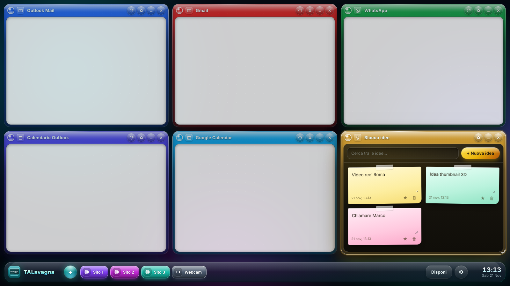

# TALavagna 1.1.0



**Download:** scarica `TALavagna-1_1_0-Windows.zip` dalla pagina [Releases](../../releases/latest).

Dashboard desktop per Windows con finestre flottanti: Outlook Mail, Calendario Outlook, Gmail, Google Calendar, WhatsApp, fino a 5 siti, fino a 4 webcam e il Blocco idee.

## Novità 1.1.0
- Nuova grafica **Glass Aurora**: sfondo aurora animato, finestre in vetro colorato glossy 3D con bordo luminoso, pulsanti a gemma, dock flottante smerigliato, menu e impostazioni in vetro scuro, Blocco idee a post-it.
- Animazioni morbide di apertura, iconizzazione e hover (disattivate se Windows ha "Effetti animazione" spenti).

## Avvio
1. Estrai lo zip (tasto destro → *Estrai tutto*): ottieni la cartella **TALavagna**.
2. Sposta la cartella dove vuoi (es. Documenti) e apri **TALavagna.exe** al suo interno.
3. Se Windows SmartScreen avvisa "app non riconosciuta" (non è firmata): *Ulteriori informazioni → Esegui comunque*.
4. Per comodità: tasto destro su TALavagna.exe → *Mostra altre opzioni → Invia a → Desktop (crea collegamento)*.

Se non si apre nulla, guarda il file di registro: `%APPDATA%\TALavagna\talavagna-log.txt` (incolla l'indirizzo nella barra di Esplora file).

## Primo utilizzo
1. Accedi una volta in ogni finestra: Outlook (account Microsoft), Gmail (account Google, vale anche per Google Calendar), WhatsApp (QR dal telefono: Dispositivi collegati). Le sessioni restano salvate.
2. Se usi un account Outlook di lavoro/scuola: ⚙ in basso a destra → Account Microsoft → *Lavoro o scuola*.
3. Siti: apri le chip "Sito 1/2/3" dalla barra in basso e scrivi l'indirizzo.

## Comandi
- **Spostare**: trascina dalla barra colorata. Vicino a un'altra finestra o al bordo scatta la calamita (linea azzurra).
- **Ridimensionare**: trascina bordi e angoli (maniglietta in basso a destra).
- **Ingrandire**: doppio clic sulla barra.
- **Colore**: pallino a sinistra della barra → 16 colori.
- **Iconizza** (–): la finestra va nella barra in basso. **X**: chiude. Si riapre dal tasto **+**.
- **Disponi**: mette tutte le finestre aperte in griglia.
- Finestra selezionata = opaca al 100%; le altre restano leggermente trasparenti (regolabile in ⚙).
- Gmail e Outlook si aggiornano ogni 10 minuti (non mentre ci stai scrivendo). Il numero di non lette compare nella barra.
- Ingranaggio di ogni finestra: nome, zoom (vista più compatta), indirizzo sito, impostazioni webcam, "Modalità compatibilità accesso" se Google rifiuta il login.

## Webcam IP
Supportati flussi **MJPEG**, **immagine istantanea** e **pagina web** della telecamera. RTSP non ancora supportato.

## Sviluppo
```
npm install
npm start          # avvio
npm run dist       # crea zip e .exe portatile in dist/
```
